# How BirdView's data is built

Every number on a BirdView page comes from a published source, through a fixed sequence of
commands. This page shows that sequence: each source and table as a box listing its fields, and
each step as an arrow saying what it does — a filter, a join, a model.

**How to read the fields.** Each box lists one field per line, and each field carries one mark:
★ it reaches a page, · the pipeline uses it without showing it — a join key, a filter, a
denominator — and ✗ nothing downstream uses it. A field that is shown may be used as well. The
unused ones are listed because a reader auditing the pipeline would otherwise wonder whether they
were forgotten. Italics are notes, given where a field's name does not say enough, and under a
box's name they say where it lives.

Square boxes are data: a published source, a table in code, or a file a command writes. Rounded
boxes are things that run: a command, or a numbered step inside `birdview-ingest`. The steps are
not files; the ingest runs all nine in memory and writes only `species.json`. Dotted arrows are
facts copied into code, rather than data read by a program. The same legend is in the
diagram's corner.

```mermaid
flowchart TB
  subgraph LEGEND["Legend"]
    direction TB
    LT["`Table or source
    *where it lives, its license*
    ─────────────
    field ★ *a note, where the name is not enough*`"]
    LM["`★ reaches a page
    · used, not shown
    ✗ not used`"]
    LS(["Command, or a step
    inside birdview-ingest"])
    subgraph LDOT[" "]
      direction LR
      LA["a published fact"] -.->|"dotted: copied into code"| LB["a table in code"]
    end
    subgraph LSOLID[" "]
      direction LR
      LC["a table"] -->|"solid: read by a program"| LD(["a command"])
    end
    %% Invisible links stack the legend in order: the table, then its marks.
    LT ~~~ LM ~~~ LS ~~~ LDOT ~~~ LSOLID
  end
  style LDOT fill:none,stroke:none
  style LSOLID fill:none,stroke:none

  subgraph SRC["Published sources"]
    AVL["`AviList v2025b
    *third_party/avilist, CC BY 4.0*
    ─────────────
    Taxon_rank · *keep species rows*
    Sequence · *family order*
    Scientific_name ★ *also the join key*
    English_name_Clements_v2025 ★ *North American name*
    English_name_AviList ★ *world name*
    Species_code_Cornell_Lab ★ *also the page address*
    Family ★
    Family_English_name ★
    Order ★`"]
    AVO["`AVONET v7
    *third_party/avonet, CC BY 4.0*
    *sheets AVONET1_BirdLife, AVONET2_eBird, AVONET3_BirdTree*
    ─────────────
    Species1 · *join key, BirdLife names*
    Species2 · *join key, eBird names*
    Species3 · *join key, BirdTree names*
    Order1-3 · *wingspan model groups*
    Beak.Length_Culmen ★ *bill*
    Tail.Length ★ *tail*
    Wing.Length ★ *wing chord*
    Mass ★ *also the head and body models*
    Habitat ★
    Trophic.Niche ★ *diet*
    Trophic.Level ★ *a second diet, where it says Omnivore*
    Family1-3 ✗
    Secondary1 ✗`"]
    FOX["`Fox, Brunton and Shephard wingspans
    *third_party/foxwingspan, CC BY 4.0*
    ─────────────
    Species1 · *join key, BirdLife names*
    needs_prediction · *keep measured rows only*
    wingspan_reported_mid_all ★ *wingspan*
    wingspan_reported_min_all ★ *range*
    wingspan_reported_max_all ★ *range*`"]
    OCC["`GBIF occurrence search
    *live API, CC BY 4.0*
    *eBird EOD and iNaturalist research-grade*
    ─────────────
    taxonKey · *birds only*
    country · *US or CA*
    datasetKey · *which source*
    verbatimScientificName · *the name as published*
    gadmGid · *state or province*
    gadmLevel0Gid · *on land or off*
    decimalLatitude · *each sea's box*
    decimalLongitude · *each sea's box*
    month ·
    eventDate · *episodes and years*`"]
    SENS["`eBird Sensitive Species list
    *web page*
    ─────────────
    species ·
    region ·
    date window ·`"]
    TAXA["`iNaturalist taxa API
    *live*
    ─────────────
    id ★ *link to iNaturalist*
    name · *exact match*
    rank · *species only*
    preferred_common_name · *must agree*
    names · *English names, for the same check*`"]
    BACK["`GBIF backbone API
    *live*
    ─────────────
    key ·
    canonicalName ·
    rank · *species-rank synonyms only*
    family ·`"]
  end

  subgraph CODE["Tables maintained in code"]
    NAMES["`internal/taxonomy
    *one function, Occurrence, applies them all*
    ─────────────
    AviListRenames ★ *under Recorded as*
    CountedAs ★ *under Recorded as*
    SharedNames ★ *under Recorded as*
    DomesticForms ★ *under Recorded as*
    Renames · *AVONET's names*
    NearMatches ★ *near-match provenance*
    NearMatchSheets · *the sheet a near-match borrows from*
    OwnRowSheets · *the sheet a species' own row comes from*
    NotInAviList · *dropped at step 2*
    OrderCommonNames ★ *order names*`"]
    TSENS["`taxonomy.EBirdSensitive
    ─────────────
    Species ·
    Region ·
    Where ✗ *eBird's wording, for checking*
    From ·
    To ·
    WithheldByEBird ★ *derived; noted on the species page*`"]
    DECL["`status.Declared
    *declared exceptions*
    ─────────────
    scientific name · *added to scope*
    reason · *printed in the build report*
    status.Exotic ★ *escapes off the index, with a reason each*`"]
    TRAIT["`internal/trait
    ─────────────
    Supplementary ★ *habitats and diets BirdView adds*
    plantFoodOf ★ *the plant half of a mixed diet*
    plantFoodOfSpecies ★ *the same, per species*`"]
  end

  PREV["`web/data/species.json, the previous build
  *the file birdview-ingest writes, read back by three generators*
  ─────────────
  id ·
  scientificName · *the species to look up*
  names · *the North American name, checked against iNaturalist's*`"]

  STATUSCMD(["birdview-status"])
  REGIONSCMD(["birdview-regions"])
  INATCMD(["birdview-inatmap"])
  NAMESCMD(["birdview-names"])
  GBIFCMD(["birdview-gbifmap"])

  subgraph DATA["Committed tables in data/"]
    STATUS["`status.tsv
    ─────────────
    name · *join key, as the records spell it*
    status ★ *established, rare, vagrant, historical, absent*
    region ★
    episodes ★
    years ★
    records ★
    commonest region ✗
    its records there ✗
    all bird records there ✗
    last seen ★`"]
    REGIONS["`region-presence.tsv
    ─────────────
    region id · *on total rows*
    every bird record there, by month · *the denominator*
    scientific name · *join key*
    region:jan|…|dec ★ *counts by month*
    ~ · *under the bar: counted, not listed*
    !flags ★ *months eBird withholds*`"]
    INAT["`inat-taxa.tsv
    ─────────────
    scientific name · *join key*
    taxon id ★ *link to iNaturalist*
    common name as iNaturalist returned it ✗ *for the audit trail*`"]
    SN["`source-names.tsv
    *read only by the name-agreement check*
    ─────────────
    id ·
    scientific name ·
    ebird ·
    inaturalist ·`"]
    GT["`gbif-taxa.tsv
    *read by nothing yet*
    ─────────────
    gbif scientific name ✗
    gbif species key ✗
    avilist scientific name ✗
    tier ✗`"]
  end

  subgraph INGEST["birdview-ingest: nine steps, in memory; only species.json is written"]
    S1(["Step 1: scope
    keep established or rare;
    add Declared and both halves
    of a shared name; flag Exotic"])
    S2(["Step 2: names and families
    join AviList on scientific name;
    drop NotInAviList;
    family order and colors"])
    S3(["Step 3: measurements
    own row from the eBird sheet,
    or the sheet OwnRowSheets names;
    else via Renames; else NearMatches,
    from the sheet NearMatchSheets names"])
    S4(["Step 4: segments
    head and body modeled from Mass;
    neck from body × family ratio;
    total length = sum of segments"])
    S5(["Step 5: habitat and diet
    AVONET's classes
    plus supplements"])
    S6(["Step 6: wingspan
    Fox's measured row if any;
    else a log-log fit on Wing.Length
    within the order"])
    S7(["Step 7: not drawn
    species out of scope keep
    their status and evidence,
    named from AviList"])
    S8(["Step 8: links
    attach the iNaturalist taxon id"])
    S9(["Step 9: regions
    attach counts, months, withheld flags;
    regions under the bar counted apart;
    peak share gives the top region"])
  end

  JSON["`web/data/species.json
  *build artifact, not committed*
  ─────────────
  id ★ *the page address*
  names ★
  scientificName ★
  speciesCode ★
  family ★
  familyCommon ★
  familyColor ★
  familyTextColor ★
  order ★
  segments ★ *each with its provenance, which also finds shared rows*
  totalLength ★ *with its provenance*
  wingspan ★ *with its provenance*
  wingChord ★ *with its provenance*
  mass ★ *with its provenance*
  habitats ★ *each with its origin*
  niches ★ *each with its origin*
  regions · *the region filter*
  regionCounts ★ *the 1 in N*
  regionMonths · *the month filter*
  regionWithheld ★
  belowRegions · *the 1 in N, never a filter*
  belowCounts · *the same*
  belowMonths · *the same*
  commonest ★
  inatTaxonId ★
  families ★ *names, orders, colors*
  regionTotals · *the denominator*
  regionMonthlyTotals · *the denominator, by month*
  sourceVersions · *what the build was made from*
  exotic ★ *why it is off the index; /excluded*
  undrawn ★ *status, region, episodes, years, records, last seen*`"]
  SERVER(["birdview server
  1 in N and the month filter,
  computed per request;
  species sharing a measured row,
  found from the provenance;
  exotics left off the index"])
  PAGES["pages
  the index
  a species
  compare
  not drawn"]

  OCC -->|"facet names by region, both sources;
  dates for each species in its top 3 regions"| STATUSCMD
  NAMES -->|"normalize every name"| STATUSCMD
  TSENS -->|"confirm withheld months"| STATUSCMD
  STATUSCMD -->|"recurrence on eBird's dates,
  iNaturalist's only where eBird withholds"| STATUS

  OCC -->|"facet names by region × 13 months;
  off-land counts for each sea"| REGIONSCMD
  NAMES -->|"normalize every name"| REGIONSCMD
  TSENS -->|"confirm withheld months"| REGIONSCMD
  REGIONSCMD -->|"count eBird, iNaturalist only in confirmed gaps;
  present at 1 per million; every count kept"| REGIONS

  SENS -.->|"restated as facts"| TSENS
  TAXA --> INATCMD -->|"exact name and common name agree"| INAT
  OCC --> NAMESCMD -->|"records per source under each AviList name"| SN
  OCC -->|"species in eBird's US and Canada records"| GBIFCMD
  BACK --> GBIFCMD
  AVL --> GBIFCMD
  GBIFCMD --> GT

  PREV -->|"the species to look up"| REGIONSCMD
  PREV -->|"the species to look up"| INATCMD
  PREV -->|"the species to look up"| NAMESCMD
  NAMES -->|"retry under the pre-AviList name"| INATCMD

  STATUS --> S1
  DECL --> S1
  S1 --> S2 --> S3 --> S4 --> S5 --> S6 --> S7 --> S8 --> S9 --> JSON
  STATUS -->|"species left out of scope"| S7
  AVL --> S2
  AVL --> S7
  NAMES --> S3
  AVO --> S3
  AVO --> S4
  AVO --> S5
  TRAIT --> S5
  FOX --> S6
  AVO --> S6
  INAT --> S8
  REGIONS --> S9

  JSON --> SERVER
  NAMES -->|"Recorded as, read directly"| SERVER
  TSENS -->|"withheld notes, read directly"| SERVER
  SERVER --> PAGES
```

The diagram above is drawn on GitHub straight from this file. On BirdView's own documentation it
is a pre-rendered picture of the same source, so the page needs no network to draw it.

## The steps

**Scope comes from recurrence.** `birdview-status` asks GBIF which names each state and province
records, then fetches the dates behind each species in its three best regions and classifies it:
*established* when its records recur in repeated episodes across years. eBird's dates count
everywhere; iNaturalist's count only in a region and month where eBird is confirmed to withhold
the species. See [where the data comes from](data.md#scope) and
[decisions.countEbirdFirst](../river/requirements/decisions.md#countebirdfirst).

**Region counts come from the same source, finer.** `birdview-regions` asks GBIF for every name in
every region, once for the year and once for each month, and counts the off-land records inside
each sea's box separately. A species is *present* in a region at 1 record per million of what is
recorded there. eBird's records count everywhere; iNaturalist's fill in only where eBird's
[Sensitive Species list](data.md#when-the-sources-disagree-about-a-name) names the species and the
records confirm the gap ([decisions.ebirdSilenceNotAbsence](../river/requirements/decisions.md#ebirdsilencenotabsence)). Records in a region where a species
stays under the bar are kept too, marked `~`: the ingest counts them in the *1 in N* and leaves
the species off that region's list ([decisions.belowBarCounted](../river/requirements/decisions.md#belowbarcounted)).

**Escapes are flagged, not dropped.** `status.Exotic` is a declared list of birds whose records
here are escapes or birds kept by people. The ingest marks each with its reason; the server
leaves them off the index and its controls, lists them at `/excluded`, and keeps their pages
([product.escapedBirdsListed](../river/requirements/sources/product/measurements.md#escapedbirdslisted)).

**Names are normalized before anything is matched.** Both commands pass every published name
through one function, `taxonomy.Occurrence`: subspecies reduced to their species, hybrids left
unmatched, genus moves and boundary disagreements mapped to the AviList name. The tables it
uses are listed on each species' page under *Recorded as*.

**The ingest joins everything into one file, in nine steps.** It keeps the in-scope species
(step 1), names them and their families from AviList (2), measures them from AVONET (3), models
the segments no source measures (4), assigns habitat and diet (5), takes wingspan from Fox where it
was measured and estimates it where it was not (6), records the species it does not draw and why
(7), and attaches the iNaturalist link (8) and the region counts (9). Every metric carries its provenance — *measured*, *near-match* or
*modeled* — and the page shows which. See [what is measured and what is modeled](data.md).

**AVONET has three taxonomy sheets, and step 3 chooses between them.** A species' own row is read
from the eBird sheet unless `OwnRowSheets` names a narrower one: the eBird sheet's *Larus
argentatus* contains every herring gull, so European Herring Gull is read from the BirdLife sheet
([decisions.herringGullEuropeanRow](../river/requirements/decisions.md#herringgulleuropeanrow)). A species with no row of its own borrows a relative's,
labeled *near-match*, from the sheet `NearMatchSheets` names where one holds a narrower concept
of that relative ([decisions.whiteTernBorrows](../river/requirements/decisions.md#whiteternborrows)). The build stops if a named sheet lacks
the row, rather than falling back to a broader one.

**The server does the last arithmetic.** The *1 in N* on a tile and the month filter depend on the
regions and months a reader selects, so they are computed per request from the counts and totals
in `species.json`, not stored. It also groups the species drawn from the same AVONET row, from
their provenance, and notes each pair on both tiles
([product.borrowedMeasurementsSaySo](../river/requirements/sources/product/measurements.md#borrowedmeasurementssayso)).

## Where to go next

- For what each figure means and how far to trust it: [where the data comes from](data.md).
- For running the pipeline yourself: [building BirdView](building.md).
- For every source's license, version and hash: [the source register](../river/requirements/requirements.md).
