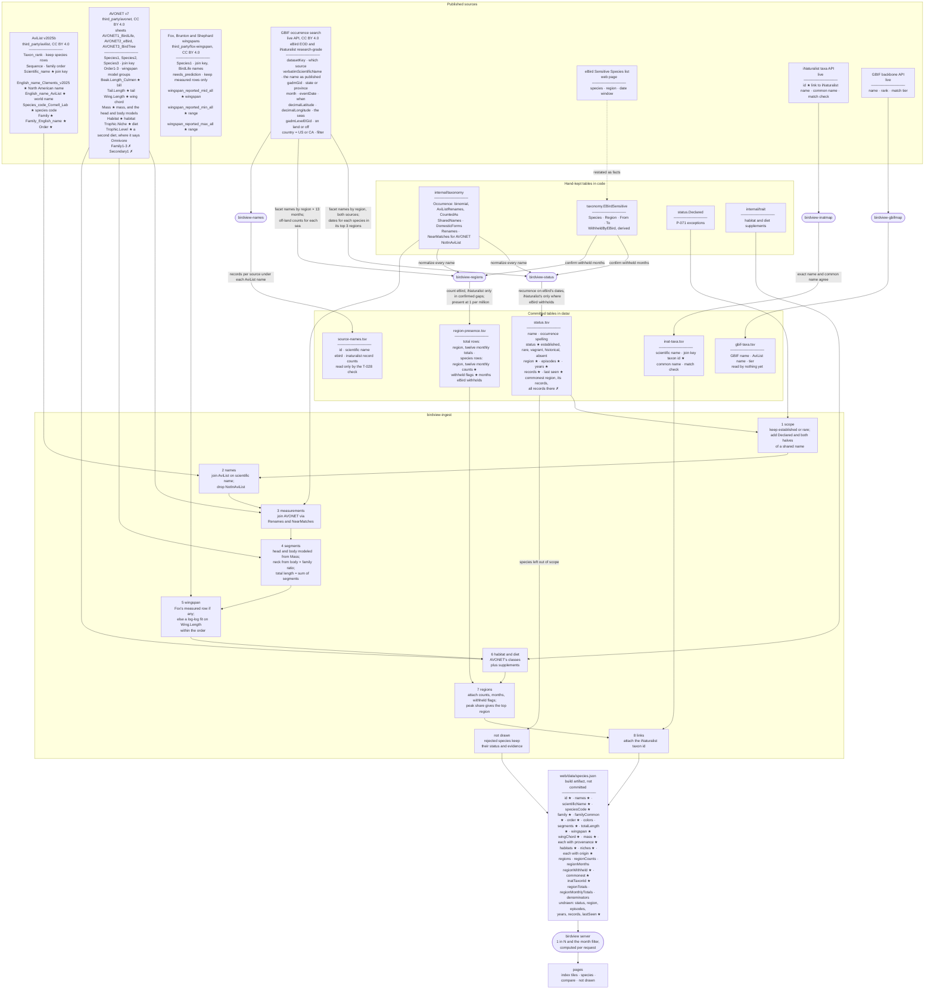

# How BirdView's data is built

Every number on a BirdView page comes from a published source, through a fixed sequence of
commands. This page shows that sequence: each source and table as a box listing its fields, and
each step as an arrow saying what it does — a filter, a join, a model.

**How to read the fields.** ★ marks a field that reaches a page. · marks one the pipeline uses
to decide something — a join key, a filter, a denominator — without showing it. ✗ marks one that
is read and then not used, which is listed because a reader auditing the pipeline would
otherwise wonder.

Rounded boxes are commands. Square boxes are tables. Dotted arrows are facts copied by hand into
code, rather than data read by a program.

The diagram above is drawn on GitHub straight from this file. On BirdView's own documentation it
is a pre-rendered picture of the same source, so the page needs no network to draw it.

## The steps

**Scope comes from recurrence.** `birdview-status` asks GBIF which names each state and province
records, then fetches the dates behind each species in its three best regions and classifies it:
*established* when its records recur in repeated episodes across years. eBird's dates count
everywhere; iNaturalist's count only in a region and month where eBird is confirmed to withhold
the species. See [where the data comes from](data.md#scope) and
[CR-038](../spec/decisions.md#cr-038).

**Region counts come from the same source, finer.** `birdview-regions` asks GBIF for every name in
every region, once for the year and once for each month, and counts the off-land records inside
each sea's box separately. A species is *present* in a region at 1 record per million of what is
recorded there. eBird's records count everywhere; iNaturalist's fill in only where eBird's
[Sensitive Species list](data.md#when-the-sources-disagree-about-a-name) names the species and the
records confirm the gap ([CR-037](../spec/decisions.md#cr-037)).

**Names are normalized before anything is matched.** Both commands pass every published name
through one function, `taxonomy.Occurrence`: subspecies reduced to their species, hybrids left
unmatched, genus moves and boundary disagreements mapped to the AviList name. The tables it
uses are listed on each species' page under *Recorded as*.

**The ingest joins everything into one file.** It keeps the in-scope species, names them from
AviList, measures them from AVONET, models the segments no source measures, takes wingspan from
Fox where it was measured and estimates it where it was not, and attaches the region counts and
the iNaturalist link. Every metric carries its provenance — *measured*, *near-match* or
*modeled* — and the page shows which. See [what is measured and what is modeled](data.md).

**The server does the last arithmetic.** The *1 in N* on a tile and the month filter depend on the
regions and months a reader selects, so they are computed per request from the counts and totals
in `species.json`, not stored.

## Where to go next

- For what each figure means and how far to trust it: [where the data comes from](data.md).
- For running the pipeline yourself: [building BirdView](building.md).
- For every source's license, version and hash: [the source register](../spec/sources.md).
